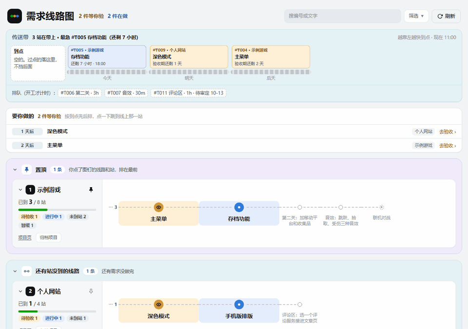
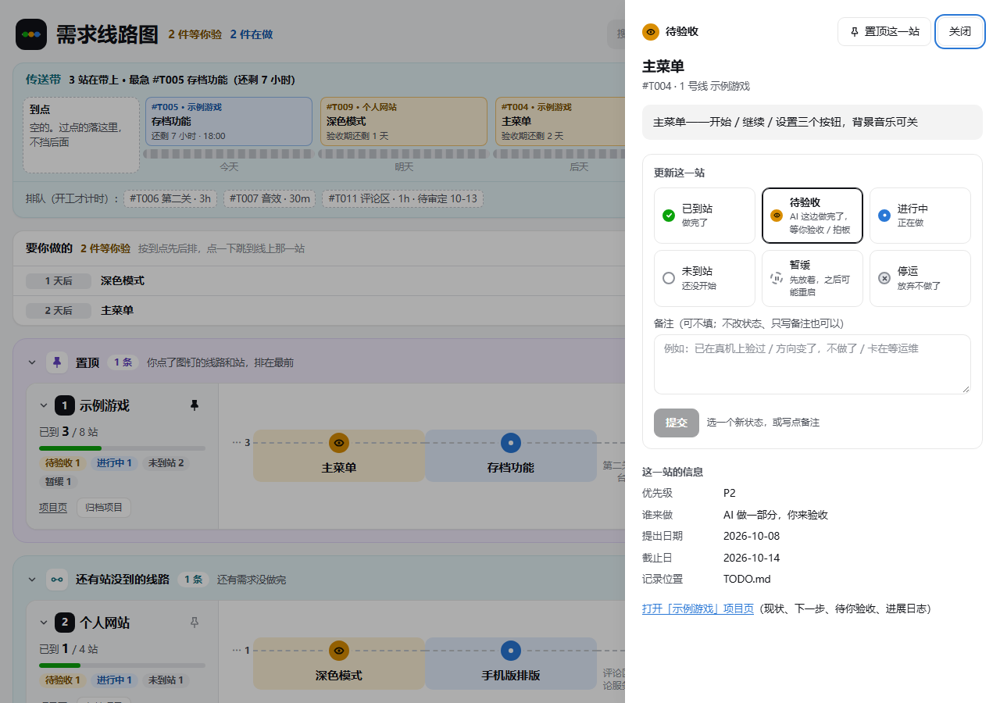
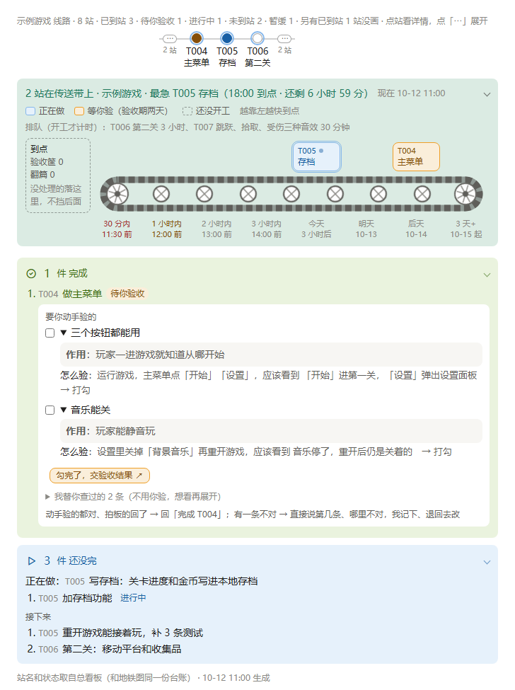
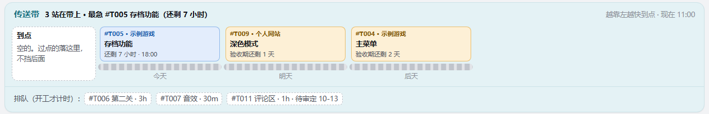
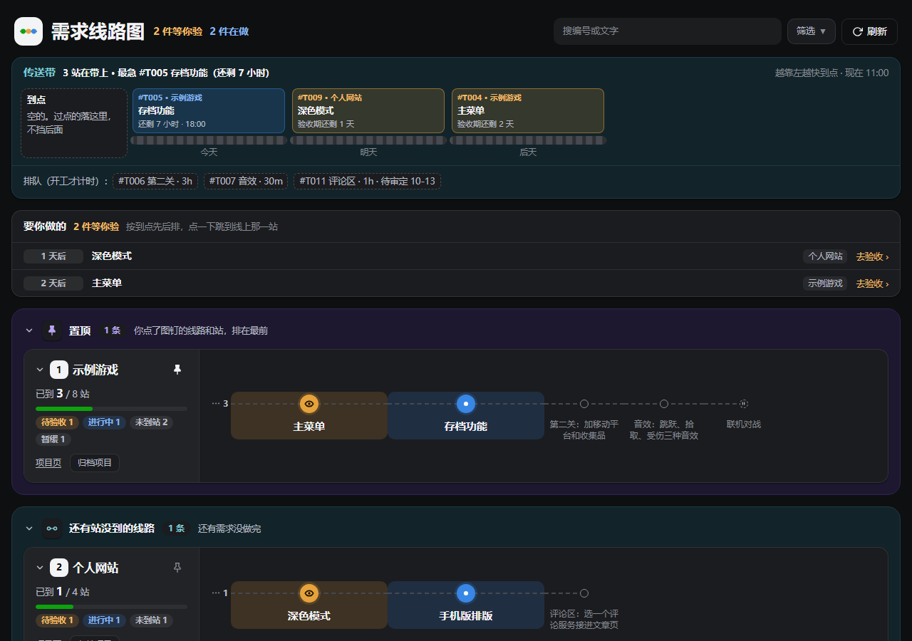

<div align="center">

# 到站 · Agent Metro

**所有项目一张地铁图：AI 干活，你验收，到站变绿。**

一个项目一条线，一个需求一站，做完到站变绿。<br>
专为「AI 干活、人来验收」设计：Claude Code / Cursor / Trae 在各个项目里干活，进度自动汇总到一张地铁图上。

[](LICENSE)


[](https://github.com/3312278735-create/agent-metro)

[快速开始](#快速开始) · [功能](#功能) · [接上 AI](#接上-ai) · [常见问题](#常见问题) · [English](README.en.md)



</div>

## 为什么做这个

同时开好几个项目、每个项目都有 AI 在干活，很快就乱了：

- **哪个做完了？** 每个 AI 都说「完成了」，但你没验过；
- **哪个在等我？** 要你拍板、要你验收的事散落在几十条聊天记录里；
- **AI 停不下来。** 一个小功能能被反复打磨一下午。

这个工具把所有项目的需求放进**一份纯文本台账**（`TODO.md`，AI 和人都能直接读写），然后画成地铁图，并给 AI 定好规矩：做完先交验收标准，到点就收尾。

和同类工具比：

| | 到站 | Backlog.md | vibe-kanban | Taskmaster |
| --- | --- | --- | --- | --- |
| 管的范围 | **你所有的项目**，一张图 | 一个仓库 | 一个仓库 | 一个仓库 |
| 数据 | 纯文本 Markdown | 纯文本 Markdown | 本地数据库 | JSON |
| 人来验收 | ✅ 待验收 + 验收标准 + 自动验收打标 | — | 看 diff | — |
| 时间预算 / 到点翻篇 | ✅ | — | — | — |
| 依赖 | 只要 Node.js | npm 包 | npm 包 | npm 包 |

## 功能

| | |
| --- | --- |
| 🚇 **地铁线路图** | 一个项目一条线，一个需求一站。绿 = 已到站，橙 = 等你验收，蓝 = 在做，灰 = 还没开工。点一站就能改状态、写备注 |
| ✅ **人来验收** | AI 做完不算完：转「待验收」，附上「怎么验、应该看到什么」，你说「完成 T004」才到站。不太紧要、AI 自己查得到结果的站可以「自动验收」，图上单独打标 |
| ⏱️ **传送带：到点翻篇** | 每站给一个时间预算（30 分钟 / 1 小时 / 2 小时），开工自动计时，到点就收尾；等你验收的站给两天，过期落进「验收筐」，不挡后面的站 |
| 💬 **进度卡** | Claude Code 每次回复末尾画一张小卡：这条线走到哪了、AI 在做什么、接下来做什么、要你定什么 |
| 📝 **变更全记录** | 你在图上的每次操作都记进 `HISTORY.md`，AI 下次开会话先读它；每次写台账前自动备份 |
| 🔌 **不挑工具** | 规则写成普通 Markdown（`PROTOCOL.md`），Claude Code、Cursor、Trae、Codex 都能照着上报 |
| 🔒 **只在本机** | 零依赖 Node.js 小服务，只监听 `127.0.0.1`；台账就是几个 Markdown 文件，可以用 git 管 |

<table>
<tr>
<td width="50%"><br><sub>点一站：看详情、改状态、写备注</sub></td>
<td width="50%"><br><sub>Claude Code 回复末尾的进度卡（带验收清单）</sub></td>
</tr>
<tr>
<td><br><sub>传送带：从左往右走、越靠右越快到点，没开工的在原料箱里排队</sub></td>
<td><br><sub>深色模式跟随系统</sub></td>
</tr>
</table>

## 快速开始

需要 [Node.js](https://nodejs.org) 18 以上。没有第三方依赖，不用 `npm install`。

```bash
git clone https://github.com/3312278735-create/agent-metro.git
cd agent-metro
```

- **Windows**：双击 **`打开地铁图.bat`**，浏览器会打开 http://127.0.0.1:47615/ ，看到的就是上面的示例。
- **mac / Linux**：`node tools/board-server.js --no-open`，再手动打开上面的地址（目前主要在 Windows 上用，页面上「服务自动重启」按钮在其他系统用不了）。

换成你自己的项目：删掉 `TODO.md` 各分区里的示例任务行（**分区标题别删**），把文件头 `next_task_id` 改回 `T001`；照 `projects/` 里的示例给每个项目建一页（`path:` 写项目在本机的目录）；清空 `ARCHIVE.md`、`HISTORY.md` 的示例条目和 `pins.json`。也可以直接让 AI 来做：「把示例数据清掉，登记我的项目：xxx 在 D:\xxx」。

## 接上 AI

看板本身只是台账 + 线路图。让 AI 按规矩上报、出进度卡、带验收标准，要把规则交给它：

1. **全局规则**：把 [`claude/全局规则片段.md`](claude/全局规则片段.md) 粘进 `~/.claude/CLAUDE.md`，把 `<看板目录>` 换成你放本仓库的路径。
2. **去验收技能**（可选）：把 `claude/skills/open-review/` 复制到 `~/.claude/skills/`。之后说「去验收 T004」，AI 先给对照图和验收标准，**你同意了才把窗口开到桌面**。
3. **看板会话**：在本仓库目录里开 Claude Code，它会读 [`CLAUDE.md`](CLAUDE.md)，懂「总览」「推进 T005」「收单」「完成 T004」这些说法。
4. **各项目里的 AI**：在每个项目的 `AGENTS.md`（Cursor / Trae 读它）或 `CLAUDE.md` 里加一节「总看板联动」，模板在 [`claude/全局规则片段.md`](claude/全局规则片段.md) 末尾；上报规矩全在 [`PROTOCOL.md`](PROTOCOL.md)。

## 台账长什么样

`TODO.md` 里一行就是一站：

```markdown
- [ ] #T005 示例游戏｜存档功能——关卡进度写进本地存档 due:2026-10-12T18:00 status:doing priority:P1 exec:mixed created:2026-10-10 budget:2h
```

- `示例游戏｜` 前面是项目名（= 哪条线），后面是需求；图上的站名取「——」之前那一段。
- `status`：`todo` 未开始 / `doing` 进行中 / `review` 待验收 / `done` 已到站 / `paused` 暂缓。
- `due` → `status` → `priority` 三个字段顺序固定，其余随意。完整说明见 `TODO.md` 里「任务格式」一节。

改状态可以在图上点，也可以用命令（AI 用的也是这套，会备份、保持格式、记变更记录）：

```bash
node tools/ledger.js set-status T005 review "存档做完，等你验"
node tools/ledger.js set-status T005 done --me        # 你亲手验收通过
node tools/ledger.js set-budget T006 1h               # 排预算，开工自动计时
node tools/ledger.js belt                             # 传送带巡检：谁到点了、谁过了验收期
node tools/ledger.js archive-project 示例游戏          # 整条线归档（restore-project 恢复）
```

不带参数跑 `node tools/ledger.js` 看全部命令。

## 进度卡

`progress-card/card.js` 读台账，按当前目录找到项目，把那条线和 AI 这一轮的状态画成一张卡：

```bash
node progress-card/card.js --text --cwd "D:/work/my-game" <<'EOF'
{"doing": {"task": "T005", "text": "写存档"},
 "next": [{"task": "T006", "text": "第二关"}],
 "you": [{"task": "T004", "title": "验收主菜单", "text": "点一遍三个按钮"}]}
EOF
```

不加 `--text` 输出 HTML（给 Claude 桌面版的可视化组件用）；加 `--text` 输出几行文字，终端里也能看。

## 目录

| 路径 | 是什么 |
| --- | --- |
| `TODO.md` | 任务台账，唯一真相 |
| `projects/<项目名>.md` | 项目页：本机路径、现状、下一步、待你验收、怎么打开验收界面、进展日志 |
| `ARCHIVE.md` · `HISTORY.md` · `pins.json` | 归档 · 变更记录（自动追加）· 置顶 |
| `PROTOCOL.md` | 各项目 AI 怎么上报、怎么接派发 |
| `CLAUDE.md` | 在看板目录里开的 AI 会话的规则 |
| `tools/ledger.js` | 读写台账的全部逻辑（命令行 + 给服务用的函数） |
| `tools/board-server.js` | 本机小服务：线路图 + 改台账的接口（只听 127.0.0.1，写操作要页面令牌） |
| `tools/build-metro.js` · `metro-template.html` | 台账 → 线路图页面；`node tools/build-metro.js` 另存一份只读的 `metro.html` |
| `tools/open-review.js` | 「去验收」：按项目页登记的方式准备 / 打开验收界面 |
| `progress-card/card.js` | 进度卡 |
| `claude/` | 给 Claude Code 的全局规则片段和「去验收」技能 |

## 常见问题

<details>
<summary><b>一定要用 Claude Code 吗？</b></summary>

不用。线路图和台账命令自己就能用；规则是普通 Markdown，Cursor、Trae 等读 `AGENTS.md` 的工具也能照着上报。进度卡和「去验收」技能是给 Claude Code 的加分项。
</details>

<details>
<summary><b>数据存在哪？会上传吗？</b></summary>

全在你本机的几个 Markdown 文件里。服务只监听 `127.0.0.1`，不联网。建议把看板目录用 git 管起来，当后悔药。
</details>

<details>
<summary><b>和 Backlog.md、vibe-kanban 有什么不一样？</b></summary>

它们管的是一个仓库里的任务；到站管的是你**所有项目**，一个项目一条线。另外多了「人来验收」和「时间预算、到点翻篇」两套规矩，专门对付「AI 说做完了但没人验」「一个小功能磨一下午」。
</details>

<details>
<summary><b>能多人一起用吗？</b></summary>

目前是给一个人管多个项目设计的。多人共用可以把看板放进一个 git 仓库，各自拉取、提交。
</details>

## Star History

[](https://star-history.com/#3312278735-create/agent-metro&Date)

## 许可

[MIT](LICENSE)
